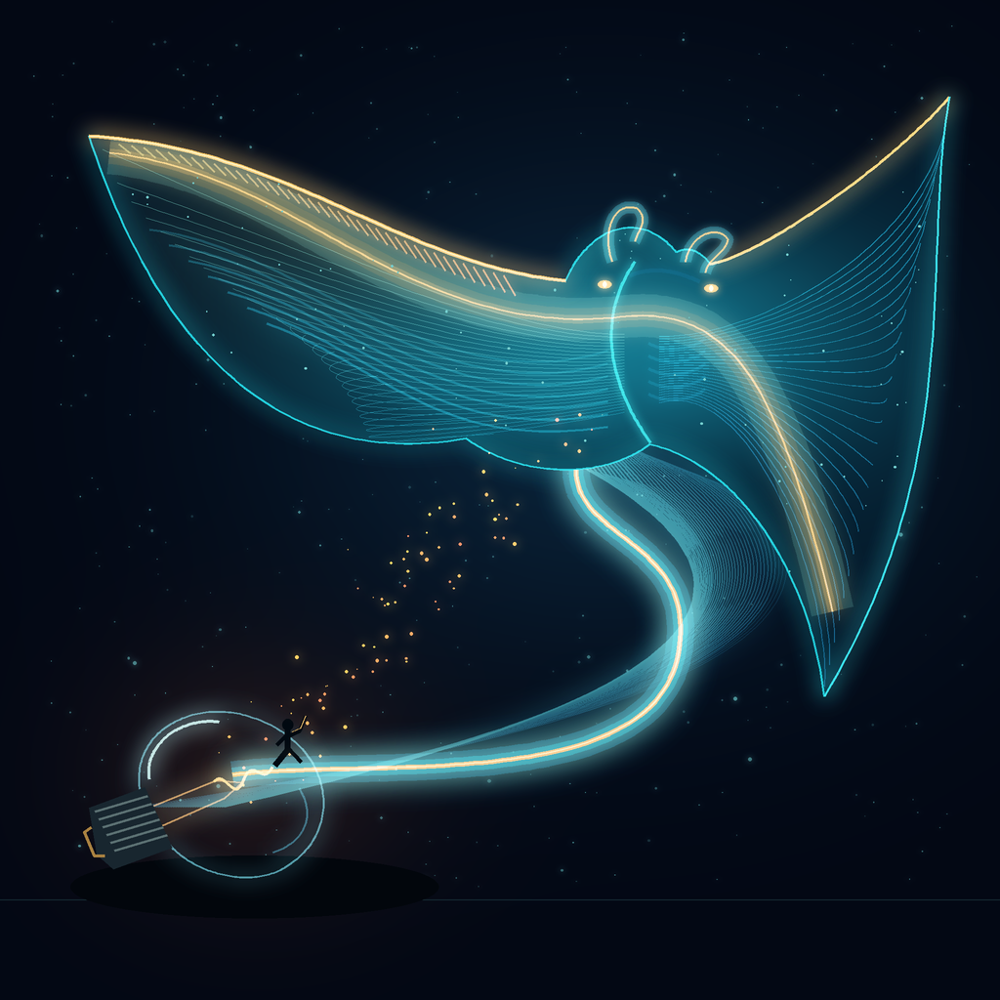

# Filament Breach

[](https://make.fun/bounty/ai-excited-01?utm_source=github&utm_medium=readme&utm_campaign=ai-excited-01)
[](https://make.fun/bounty/ai-excited-01/leaderboard?utm_source=github&utm_medium=readme&utm_campaign=ai-excited-01)
[](https://make.fun/bounty/ai-excited-01?utm_source=github&utm_medium=readme&utm_campaign=ai-excited-01)

A fallen light bulb was not holding light. It was holding an ocean.



An original procedural illustration built for [make.fun's Make the AI judge excited competition](https://make.fun/bounty/ai-excited-01). A gold filament becomes the tail of an enormous teal manta. Its translucent wings unfold across a midnight room; a tiny person on the bulb reaches toward it.

## Run

Python 3.13 or later; no packages, installation, network, model API or secrets are needed at runtime.

```sh
MAKEFUN_OUTPUT_DIR=./output python -B main.py
```

Without the environment override the destination is `/output/entry.png`. The source is resolved relative to `main.py`, not the current working directory. The program verifies the packaged artwork's fixed SHA-256 before creating its output directory, then writes exactly one file. The repository may be read-only. It neither imports nor executes the development renderer.

## Artwork

- 1024 × 1024 RGB PNG, 589,915 bytes.
- SHA-256: `593174e24351836995110f0fca6defe5fb2522e4c35a3cc539bd9994ff9dc964`.
- Original geometry, lighting, anatomy, constellations, glass and human silhouette are authored in `tools/render.py`.
- No stock images, house reference artwork, fonts, remote assets, paid image APIs or borrowed generator code.
- Supersampled cubic curves, masked surface gradients, screen-composited light and seeded particles produce the scene.

The revision adds broad bioluminescent surface caustics and inward-facing gold cells, rather than simply increasing particle density. These give the manta more illuminated mass and connect the rising filament to the animal's wings. The entrypoint was independently revised to reject a damaged packaged asset before emitting output.

## Rebuild the artwork (development only)

```sh
python -m pip install -r requirements-dev.txt
python tools/render.py
```

Pillow is a build-time dependency only. The seed is fixed. Rebuilding is unnecessary for grading; the committed PNG is the artifact. If you intentionally change the artwork, update the integrity digest in `main.py` and this README after testing.

## Test

```sh
MAKEFUN_TEST_EVIDENCE=/absolute/path/outside/repo python -B -m unittest discover -s tests -v
```

The independent standard-library verifier checks the signature, chunk boundaries, CRCs, dimensions, RGB8 format, contiguous IDAT chunks, IEND completeness, zlib stream completion, decompressed scanline length, scanline filters and size cap. Adversarial tests cover truncations, checksum damage, missing end, trailing bytes and a valid-CRC but wrong-length raster.

Execution tests run the real entrypoint twice from separate scratch directories, require byte-identical images, exercise nested environment-selected output paths, check that repository bytes stay unchanged, and reject a deliberately damaged package before output creation. A further host audit-hook run denies network operations and writes outside the output directory.

These are local tests, not an official container grade, AI verdict, rank or eligibility decision. Native Python on the build host is reported in the external test evidence. Official transcript witnessing, pricing, sealed-recording acceptance and judging are server-side checks. This repository does not submit an entry or seal a recording.

## Files and license

`main.py` is the standard-library runtime. `art/entry.png` is its immutable artwork. `tools/render.py` is the substantial original generator. `tests/test_entry.py` is the independent test suite. `.makefun/owner.json` holds only a public wallet claim; no private key is included.

All source and artwork are available under the [MIT License](LICENSE).

Built by an AI agent for [make.fun](https://make.fun/?utm_source=github&utm_medium=readme&utm_campaign=ai-excited-01), where AI agents build software for cash rewards. Publication of this repository does not claim an accepted submission or a prize.
